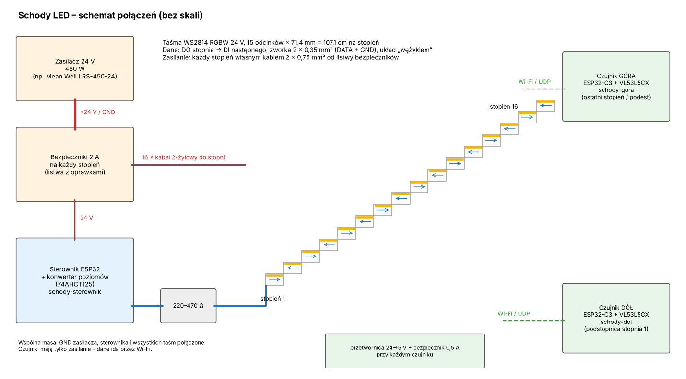
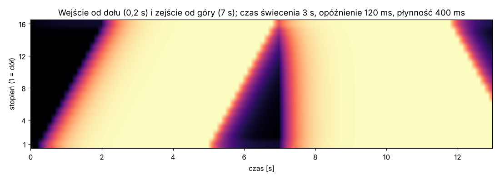

# Schody LED na ESP32 (ESPHome + Home Assistant)

Podświetlenie 16 stopni taśmą adresowalną **WS2814 RGBW 24 V**, zapalane stopień po stopniu w kierunku, w którym idziesz. Ruch wykrywają dwa laserowe czujniki **VL53L5CX** (8×8 stref) schowane w podstopnicy pierwszego stopnia i przy ostatnim stopniu.

Wszystko działa lokalnie: czujniki wysyłają ruch prosto do sterownika po UDP, więc schody świecą także wtedy, gdy Home Assistant nie działa. HA służy do ustawień i podglądu.

  

> 🧪 **Status: wersja testowa.** Program się waliduje i logika animacji jest sprawdzona w symulacji, ale całość nie była jeszcze uruchomiona na moich schodach. Zgłaszaj problemy w Issues.

> ⚠️ Zasilacz 24 V 480 W podłączasz do 230 V. Jeśli nie czujesz się pewnie, podłączenie zasilacza zostaw elektrykowi.

---

## Komponenty

| Element | Ilość | Uwagi |
|---|---|---|
| Taśma COB **WS2814 RGBW 24 V**, cięcie co 71,4 mm | 4 rolki × 5 m | 15 odcinków = 107,1 cm na stopień, razem 17,1 m |
| Profile aluminiowe z mlecznym kloszem | 16 × ok. 110 cm | odprowadzają ciepło (20 W/m) |
| Zasilacz **24 V 480 W** (np. Mean Well LRS-450-24 / HLG-480H-24) | 1 | pełna biel to ok. 345 W |
| Bezpieczniki 2 A z oprawkami (lub listwa) | 16 | jeden na stopień |
| Sterownik **ESP32** z konwerterem poziomów 3,3 → 5 V na linii danych | 1 | np. płytka typu „WLED controller 24 V” albo ESP32 DevKit + 74AHCT125 |
| Rezystor 220–470 Ω na wyjściu danych | 1 | przy sterowniku |
| **ESP32-C3 SuperMini** | 2 | czujnik dół i góra |
| **VL53L5CX** (moduł na płytce, I2C) | 2 | |
| Przetwornica 24 → 5 V (np. MP1584, ustawiona na 5,0 V) + bezpiecznik 0,5 A + kondensator 470 µF | 2 | zasilanie czujników z linii 24 V |
| Przewód 2 × 0,75 mm² do każdego stopnia, zworki 2 × 0,35 mm² (DATA + GND) między stopniami | – | |

> ESP8266 (NodeMCU v3) nie wystarczy na VL53L5CX – sterownik czujnika potrzebuje więcej RAM, dlatego czujniki są na ESP32-C3.

## Podłączenie

**Sterownik**

| Zacisk | Co podłączone |
|---|---|
| GPIO16 (`led_pin`) | przez konwerter poziomów i rezystor 220–470 Ω do DI taśmy stopnia 1 |
| GND | masa zasilacza 24 V i masa taśm |
| zasilanie | 24 V (płytki 24 V) albo 5 V z przetwornicy |

**Czujnik (ESP32-C3 SuperMini)**

| Pin C3 | VL53L5CX |
|---|---|
| 3V3 | VIN (lub 5 V, jeśli moduł ma stabilizator) |
| GND | GND |
| GPIO6 | SDA |
| GPIO7 | SCL |
| – | LPn: na wielu modułach podciągnięty na płytce; jeśli nie, połącz z 3V3 |

C3 zasilasz z przetwornicy 24 → 5 V (pin 5V i GND), odgałęzionej z listwy zasilającej przed taśmą, nie z samej taśmy.

**Taśmy:** dane szeregowo **DO stopnia → DI następnego**, zgodnie ze strzałkami na taśmie. Układaj „wężykiem” (stopień 1 od lewej, stopień 2 od prawej…), wtedy zworki mają po 30–40 cm. Każdy stopień dostaje 24 V i GND własnym kablem od listwy bezpieczników. Masa zasilacza, sterownika i taśm musi być wspólna.

## Jak działa program

- **Czujnik** co 0,1 s mierzy 64 strefy i porównuje je z zapamiętanym tłem pustych schodów. Gdy w co najmniej 2 strefach coś jest o 20 cm bliżej niż tło, wysyła „Ruch” po UDP do sterownika (i do HA).
- **Sterownik** po ruchu z dołu zapala stopnie od 1 do 16 (z góry odwrotnie), z opóźnieniem między stopniami i płynnym rozjaśnianiem. Dopóki ktoś stoi przed czujnikiem, schody nie gasną. Po czasie świecenia gasną w tym samym kierunku.
- Jeśli ktoś wejdzie w trakcie gaszenia, wszystko zapala się od razu, a późniejsze gaszenie idzie w kierunku tej osoby.
- **Poświata:** pierwszy i ostatni stopień mogą świecić delikatnie cały czas (w nocy).
- **Tylko w nocy:** automatyka działa w wybranych godzinach (zegar z SNTP, bez HA).
- Ustawienia zapisują się w pamięci ESP i przetrwają restart.

## Encje w Home Assistant

**schody-sterownik**

| Encja | Typ |
|---|---|
| Światło (kolor, biel, jasność; efekt „Schody auto” = automatyka, bez efektu = świeci wszystko) | light |
| Automatyka, Tylko w nocy, Poświata pierwszego i ostatniego stopnia | switch |
| Ruch dół, Ruch góra, Schody świecą | binary_sensor |
| Opóźnienie między stopniami, Czas świecenia, Płynność rozjaśniania, Poświata – jasność, Noc od / do godziny | number (konfiguracja) |
| Test od dołu, Test od góry, Restart | button |

**schody-dol / schody-gora**

| Encja | Typ |
|---|---|
| Ruch | binary_sensor |
| Odległość, Strefy z ruchem | sensor |
| Czułość – margines, Zasięg maks., Min. liczba stref | number (konfiguracja) |
| Kalibruj puste schody, Usuń kalibrację, Restart | button |

Gotowa karta do panelu: [`homeassistant/karta_schody.yaml`](homeassistant/karta_schody.yaml).

## Instalacja

📘 **Dokładna instrukcja: [`docs/wgrywanie.md`](docs/wgrywanie.md)**

W skrócie:

1. W ESPHome → **Secrets** wklej `esphome/secrets.example.yaml` i uzupełnij.
2. Skopiuj cały katalog `esphome/` (razem z `components/`) do katalogu ESPHome w HA.
3. Wgraj przez USB `schody-sterownik`, `schody-dol` i `schody-gora` (**Install → Manual download → Factory format** + https://web.esphome.io).
4. Sprawdź kolejność kolorów taśmy (`channel_colors`) i kierunek przyciskiem **Test od dołu**.
5. Skalibruj czujniki.

Jeśli ESPHome zgłasza błąd przy `channel_colors`, masz starszą wersję ESPHome: zaktualizuj dodatek albo zamień tę linię na `rgb_order: GRB` i `is_rgbw: true`.

## Kalibracja czujników

1. Zamontuj czujnik i zamknij płytę stopnia.
2. Odejdź od schodów (nikt nie może stać w polu widzenia).
3. Naciśnij **Kalibruj puste schody**. Przez ok. 3 s czujnik zapamiętuje tło (ścianę, balustradę, podłogę). Tło zostaje w pamięci po restarcie.
4. Przejdź obok: **Strefy z ruchem** ma rosnąć, a **Ruch** się włączać.

Dobór ustawień:
- reaguje na drugą stronę schodów albo balustradę → zmniejsz **Zasięg maks.**
- załącza się sam → zwiększ **Czułość – margines** albo **Min. liczba stref**, powtórz kalibrację
- reaguje za późno → zmniejsz margines albo ustaw **Min. liczba stref** na 1

**Montaż:** w podstopnicy pierwszego stopnia okienko ok. 6–8 cm pod krawędzią stopnia, na środku szerokości. Czujnik patrzy poziomo przed schody. Na górze w ścianie podestu, 10–15 cm nad podłogą. Laser jest w podczerwieni (940 nm, klasa 1), więc nie świeci w oczy.

## Druk 3D

Obudowa podtynkowa czujnika (otwór pod puszkę Ø60 w betonie, regulacja pod grubość płyty): [`stl/`](stl/).

## Licencja

MIT. Korzystaj, przerabiaj, a jak coś poprawisz, wrzuć PR 🙂

Komponent `vl53l5cx_presence` korzysta z biblioteki [SparkFun VL53L5CX Arduino Library](https://github.com/sparkfun/SparkFun_VL53L5CX_Arduino_Library), pobieranej automatycznie przy kompilacji.
